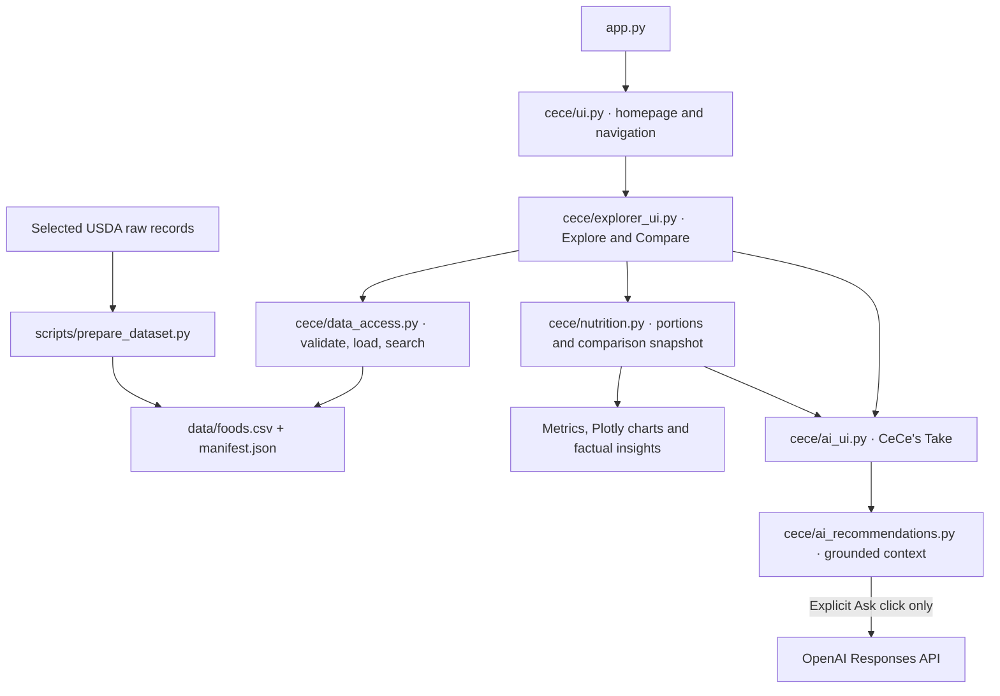

# CeCe — Your Food Bestie

**Hungry? Ask CeCe.**

CeCe helps you explore food nutrition, compare portions, and understand your options
with a friendly food companion. This Week 1 MVP combines a **local catalog of 36
curated USDA records** with interactive nutrition analysis and optional OpenAI
explanations through **CeCe's Take ✨**.


*Week 1 homepage screenshot. Food Explorer is available; planned modules are marked Soon.*

## Why CeCe?

Choosing what to eat can mean interpreting unfamiliar nutrition labels and comparing
foods in different portions or preparation states. CeCe brings the facts, portions,
and source references together, then offers a concise explanation for your goal.
It is a food discovery and analysis application—not an autonomous agent or a
personalized medical advisor.

## Implemented Week 1 features

- **Food Explorer:** case-insensitive partial-text search across USDA descriptions
  and brands, with generic/branded filters and clickable search suggestions.
- **Nutrition Breakdown:** explicit food selection, gram-based portions, five main
  metrics, and six additional nutrients in an expandable detail section.
- **Compare Foods:** up to three foods, per-100-g or selected-portion comparisons,
  interactive horizontal charts, a detailed table, and factual insights with ties.
- **Source transparency:** original USDA descriptions, FDC IDs, data types, record
  links, and image credits.
- **Food imagery:** local, attributed representative photos and illustration/product
  placeholders. Images do not establish preparation or dietary suitability.
- **CeCe's Take:** optional goal-based AI explanations grounded in the current
  comparison data. The main explorer remains usable without an API key.

## CeCe's Take ✨

The recommendation card appears at the top of Compare Foods, even before foods
are added. Ask becomes available when two or three foods are selected.

Choose **A balanced meal**, **More protein**, **More fiber**, or **Fewer calories**.
On an explicit **Ask CeCe ✨** click, Python supplies the model with selected USDA
records, preparation states where known, current comparison basis, portions,
nutrient values, missing indicators, sources, and precomputed protein density and
observations. The model interprets these facts; it is instructed not to calculate
nutrition from scratch or invent values.

The official OpenAI SDK calls the **Responses API**, requesting a short structured
recommendation. Responses remain visible across ordinary reruns. Changing foods,
goal, basis, or portions marks the previous response outdated without generating
another request. USDA source links appear beneath the response.

Calls use a **400-token output cap**, **20-second timeout**, and **zero retries**.
The default model is `gpt-4.1-mini`, configurable through `OPENAI_MODEL`. General
meal pairings are suggestions, not additional verified nutrition facts. Structured
output validates response shape; it does not guarantee factual correctness.

## Technology stack

| Layer | Technology |
| --- | --- |
| Application | Python and Streamlit |
| Local data and validation | pandas, JSON, CSV, SHA-256 |
| Interactive charts | Plotly |
| Optional AI explanations | Official OpenAI Python SDK, Responses API |
| Automated checks | Python `unittest`, Streamlit `AppTest`, mocked API responses |

Direct dependency versions are pinned in [requirements.txt](requirements.txt).
The validated development environment uses **Python 3.14.8**; transitive
requirements are not fully locked.

## Architecture



`cece/explorer_state.py` manages selection/reset transitions. `food_labels.py`,
`imagery.py`, `presentation.py`, and `charts.py` handle presentation separately
from nutrition calculations. `dietary.py` is a documented future rules boundary;
it currently makes no dietary classifications.

For function signatures, user-flow traces, and data-engineering explanations,
see the [developer walkthrough](docs/developer-walkthrough.md).

## Dataset and USDA attribution

The catalog is a **static, reproducible snapshot**, retrieved October 10, 2026:
**30 SR Legacy foods and 6 Branded products**. It is not live USDA search and does
not automatically refresh. Source ZIP archives and exact selected FDC IDs are
recorded in [data/selection.json](data/selection.json).

Records include tofu, edamame, cooked lentils, chickpeas, rice, oats, yogurt, quinoa,
produce, and exact branded examples. Complete original descriptions remain
available, even when the UI shows shorter names.

All nutrient values use a **100-g basis**. Calories use kcal; sodium and cholesterol
use mg; the other nutrients use g. Alongside calories, protein, carbohydrates,
fat and fiber, the dataset retains total sugars, added sugars, saturated fat,
trans fat, sodium and cholesterol. Each nutrient has a missing-value indicator.
**Missing means Unknown, never zero.** Added sugars are absent in all 36 records.

`data/raw/<fdc_id>.json` preserves each selected original USDA object. These 36
small files are audit/rebuild fixtures, not the runtime search store or a proposed
million-record storage design. The application loads the normalized CSV.

The manifest records counts, units, acquisition date, source information and
checksums. See [data documentation](data/README.md) for the schema, missing counts,
exact archive URLs, and re-extraction instructions.

Attribution: [USDA FoodData Central](https://fdc.nal.usda.gov/) and
[USDA dataset downloads](https://fdc.nal.usda.gov/download-datasets/).
SR Legacy is historical; branded values are label-derived snapshots and may
reflect rounding or older product versions.

## Local installation

Clone the repository and create a virtual environment. If you already have a
working `.venv`, reuse it rather than recreating it.

```sh
git clone https://github.com/srishti-piplani/food-intelligence-app.git
cd food-intelligence-app
python3.14 -m venv .venv
.venv/bin/python -m pip install -r requirements.txt
```

These commands use macOS/Linux paths and require Python 3.14 to be installed.
On Windows, use `py -3.14 -m venv .venv` and `.venv\Scripts\python.exe` for the
Python commands. Package installation requires internet access.

## OpenAI API configuration — optional

CeCe's Take requires **separate OpenAI API credentials and API billing/quota**.
A ChatGPT subscription is not the application's API credential. Obtain a key
for your API project; do not include it in commits, screenshots or documentation.

Choose one configuration method:

**Streamlit secrets:** create `.streamlit/secrets.toml` locally:

```toml
OPENAI_API_KEY = "replace-with-your-real-key-locally"
OPENAI_MODEL = "gpt-4.1-mini"
```

**Environment variables:** set them in the terminal that launches Streamlit:

```sh
export OPENAI_API_KEY="replace-with-your-real-key-locally"
export OPENAI_MODEL="gpt-4.1-mini"
```

Environment values take precedence. `OPENAI_MODEL` is optional. `.env.example`
contains placeholders; **Streamlit does not automatically load `.env`**.
Existing ignore rules exclude `.env`, `.env.*` and `.streamlit/secrets.toml`,
while allowing `.env.example`. Restart the app after configuring credentials.

Each Ask click may incur API charges. Cost depends on input/output tokens and
model choice; check [official model pricing](https://developers.openai.com/api/docs/models/gpt-4.1-mini)
and your project limits. Replacement models must support Responses and strict
JSON structured output within the configured token cap.

## Run CeCe

```sh
.venv/bin/python -m streamlit run app.py
```

Open the local URL printed by Streamlit, normally `http://localhost:8501`.
Search, nutrition and comparisons use local data. No live USDA request is made.
Without an API key, Ask CeCe shows configuration guidance rather than a fabricated
recommendation.

## Run automated tests

```sh
.venv/bin/python -m unittest discover -s tests -v
.venv/bin/python -m pip check
```

The current suite contains **58 tests** and passed in the validated environment.
Tests cover provenance, schema, missing values, portions, search, navigation,
image metadata, comparison consistency, and mocked OpenAI requests/errors.
Automated tests make no paid API calls. `AppTest` checks UI behavior rather than
pixel-level appearance; desktop/mobile layout still needs browser review.

To regenerate the dataset from bundled raw records, without network access:

```sh
.venv/bin/python scripts/prepare_dataset.py
```

This rebuilds `foods.csv` and `manifest.json`; it does not fetch new records or
change the acquisition date. Reproducibility is tested with the pinned data and
development environment.

## Example workflows

**Explore Greek yogurt:** search `Greek yogurt`, select the nonfat record FDC
**170894**, and change the gram portion to **150**. Calories become **88.5 kcal**
and protein becomes **15.3 g**. Open Detailed Nutrition and USDA Source Details
for further values, the original description, and attribution.

**Compare grains with CeCe:** add cooked white rice **168878**, brown rice
**169704**, and quinoa **168917**. Open Compare Foods, select **More protein**,
leave Per 100 g selected, and click Ask CeCe. Their verified protein values are
**2.69 g**, **2.74 g**, and **4.40 g per 100 g**, respectively. Check the explanation
against the cards and source links. Change to My portions and edit grams: the
previous take is marked outdated until you explicitly ask again.

## Reliability, limitations and safeguards

- The catalog is small, historical and curated. Search matches text, not synonyms,
  nutritional goals, recipes or live product availability.
- Portions are grams, bounded to 0–10,000 g in the UI. Python scales known nutrients
  linearly; it does not change the underlying food record or account for a new
  preparation method.
- Preparation differences matter: dry and cooked foods have different water
  content. Source descriptions and supported preparation labels remain available.
- Unknown nutrients are excluded from bars and rankings. Ties and known-value
  coverage are preserved; zero is retained only when the source supplies zero.
- No vegan, vegetarian, gluten-free, allergen-safe or medical suitability
  classifications are implemented. Missing evidence never establishes safety.
- AI explanations can still be wrong. They are not medical advice, and a single
  ingredient is not automatically a complete meal. General pairing suggestions
  have no verified numerical claims beyond the selected records.
- API authentication, quota, access, network, timeout and unexpected-response
  errors have friendly messages. No automatic generation or retries occur.
- `store=False` disables response storage for the request; it is not a blanket
  claim about all provider retention. See [OpenAI data controls](https://developers.openai.com/api/docs/guides/your-data).
- State persists across ordinary reruns/navigation within a Streamlit session;
  there is no database-backed history or account persistence.
- Direct dependencies are pinned; transitive dependencies are not fully locked.
  Automated tests do not establish browser appearance or live model quality.

## Future roadmap — not implemented

Personal Food Profile, Meal Builder, Restaurant Finder, Pantry, Festival Foods,
and AI Food Assistant remain Coming Soon. Later work may introduce evidence-based
dietary rules, a larger catalog, persistent storage, recommendations, FastAPI,
PostgreSQL, ML, RAG, tool calling or agents. These are plans, not Week 1 capabilities.

## Image credits and project documentation

- Generic food photos: [full credits and license links](assets/foods/photos/CREDITS.md).
  Pexels images use the Pexels License; Wikimedia derivatives retain their respective
  CC BY-SA licenses. Photo metadata records source, creator, modifications and hashes.
- Original fallback food SVGs: [CC0 dedication](assets/foods/LICENSE.txt), applying
  only to that folder's original illustrations.
- CeCe mascot and homepage artwork: cropped from the supplied
  [design reference](assets/cece-design-reference.png). Creator/distribution rights
  are not documented here; the food-SVG CC0 dedication does not cover this artwork.
- This repository currently has no root software license; do not infer one from
  individual asset licenses.

Further reading: [developer walkthrough](docs/developer-walkthrough.md),
[dataset details](data/README.md), [preparation scripts](scripts/README.md), and
[archived engineering history](docs/engineering-history.md). The history records
past milestones and superseded UI descriptions; this README describes the current MVP.
