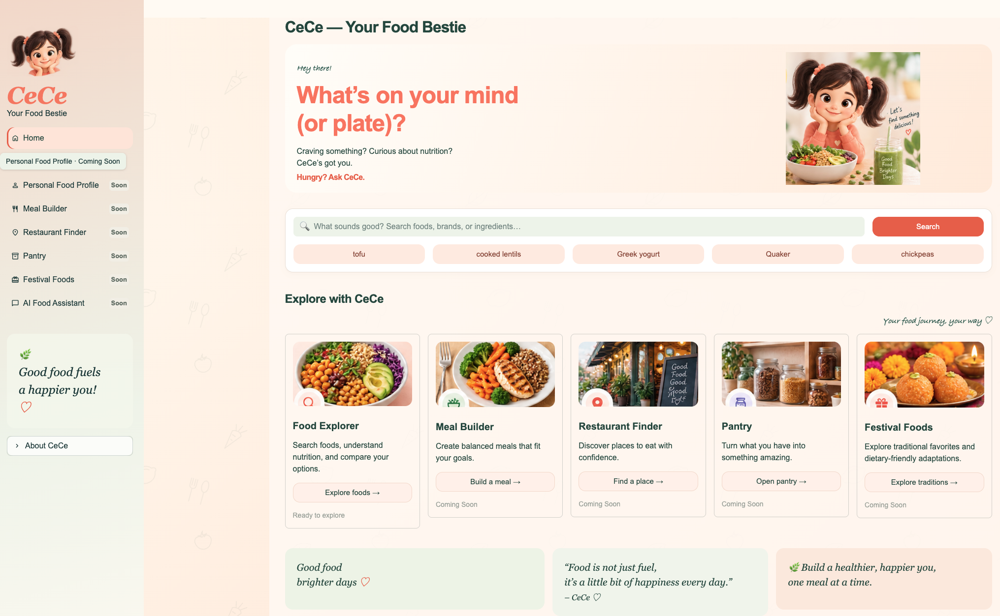

# CeCe — Your Food Bestie 🍑

### Hungry? Ask CeCe.

CeCe is your personal food companion, designed to make everyday food decisions simpler, smarter, and more enjoyable.

Whether you're wondering what to eat, comparing nutrition labels, trying to meet your protein goals, navigating dietary restrictions, or looking for a restaurant that fits your preferences, CeCe aims to bring everything together in one friendly place.

**The vision is simple: less time figuring out food, more time enjoying it.**



## 🌱 The Vision

Finding the right food isn't always easy. Nutrition information is scattered, dietary needs vary, and deciding what to eat often involves switching between multiple apps, websites, and search results.

CeCe is being built as an all-in-one food assistant that understands your preferences and helps you make informed choices.

The long-term vision includes:

- **Food Explorer:** Discover nutrition information for everyday ingredients and branded products, with portion-based comparisons.
- **Personal Food Profile:** Save dietary preferences, allergies, restrictions, and nutrition goals.
- **Meal Builder:** Plan individual meals or entire days around your preferences, goals, and what you've already eaten.
- **Restaurant Finder:** Discover places and menu options that fit your cuisine preferences and dietary needs.
- **Smart Pantry:** Turn ingredients you already have into meal ideas and reduce food waste.
- **Festival Foods:** Discover traditional dishes, dietary-friendly recipe adaptations, and places to find them.
- **AI Food Assistant:** Ask CeCe what to eat and receive context-aware suggestions.

The goal is to make CeCe a food bestie you can turn to every day. Beyond the food exploration, comparisons, and CeCe's Take described below, these capabilities are planned.

## ✨ What CeCe Can Do Today

The first version focuses on helping users **explore, understand, and compare foods**.

### 🔎 Explore Foods

Search a curated catalog of 36 USDA food records, including everyday ingredients and branded products.

- View calories, protein, carbohydrates, fat, fiber, and additional nutrients.
- Adjust portions to see how nutrition changes.
- Explore representative food photographs and preparation information where available.
- See the USDA source behind each food's nutrition values.

### 📊 Compare Foods

Compare up to three foods side by side.

- Compare nutrition per 100 g or by your chosen portions.
- Explore interactive charts for calories and nutrients.
- Understand which selected foods provide more protein or fiber, or fewer calories.
- See useful comparisons such as protein per 100 calories.

### ✨ CeCe's Take — AI-Powered Food Insights

Not sure which food to choose? Ask CeCe!

Select a goal such as **A balanced meal**, **More protein**, **More fiber**, or **Fewer calories**.

CeCe uses OpenAI to explain the nutritional differences between your selected foods and offer practical suggestions.

The recommendations are grounded in the USDA nutrition values calculated by the application, rather than relying on AI to invent nutritional information. Add at least two foods and click **Ask CeCe ✨** to generate a take. If your comparison or goal changes, the previous take is marked outdated until you ask again.

## 🛠️ Built With

**Python · Streamlit · pandas · Plotly · USDA FoodData Central · OpenAI API**

CeCe uses USDA FoodData Central for its initial nutrition catalog and the OpenAI API for goal-based food comparison explanations.

## 🚀 Run CeCe Locally

Use Python 3.11 or newer; the project was tested with Python 3.14.8. Clone the repository and install the dependencies:

```bash
git clone https://github.com/srishti-piplani/food-intelligence-app.git
cd food-intelligence-app
python3 -m venv .venv
source .venv/bin/activate
python -m pip install -r requirements.txt
```

Reuse an existing virtual environment if you already have one. These activation commands are for macOS/Linux; on Windows, use `.venv\Scripts\activate` with Command Prompt.

Start the application:

```bash
streamlit run app.py
```

Open the local URL displayed in your terminal.

### Enable CeCe's Take (Optional)

Create `.streamlit/secrets.toml` locally:

```toml
OPENAI_API_KEY = "your-api-key"
OPENAI_MODEL = "gpt-4.1-mini"
```

An OpenAI API key with separate API billing is required for AI recommendations. Food search, nutrition, and comparisons work without it. Restart Streamlit after configuring credentials.

Never commit your API key to GitHub. `.streamlit/secrets.toml` and `.env` are ignored by Git. You can also use environment variables; `.env` is not loaded automatically. Each Ask click may incur API charges.

## 🌍 Data & Transparency

CeCe currently uses a curated local catalog of 36 USDA FoodData Central records. Nutrition values are source-attributed, and missing information is identified as unknown rather than assumed to be zero.

The catalog is an initial prototype dataset, not a complete food database or live search service.

Dietary and allergy-safety recommendations are part of the future vision and are not yet implemented. AI suggestions can be wrong, are informational, and are not medical advice.

Food photographs are representative; branded products use placeholders when exact images are unavailable. Food photography credits and licensing information are available in [CREDITS.md](assets/foods/photos/CREDITS.md). See [artwork and licensing notes](docs/engineering-history.md#artwork-and-licensing) for the mascot and other assets.

For technical details, see the [developer walkthrough](docs/developer-walkthrough.md), [dataset documentation](data/README.md), and [script usage](scripts/README.md).

---

**CeCe — Your Food Bestie.**

*Good food fuels a happier you! ♡*
