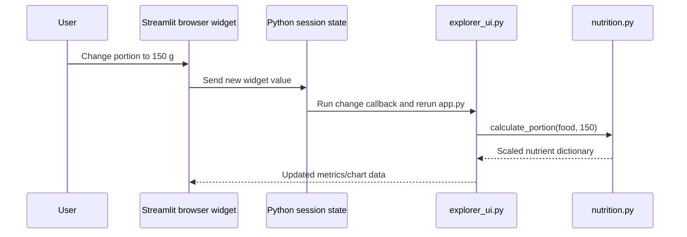

# CeCe Week 1 developer walkthrough

This guide describes the current implementation. CeCe combines deterministic
nutrition calculations with an optional generative explanation. It does not
contain a chatbot loop, an autonomous agent, a database or live USDA search.

## How the initial data was acquired

The sample was extracted from two public **USDA bulk JSON ZIP archives**:

- SR Legacy: `FoodData_Central_sr_legacy_food_json_2018-04.zip`.
- Branded: `FoodData_Central_branded_food_json_2026-04-30.zip`.

The exact URLs, archive SHA-256 values and chosen FDC IDs are in
[`data/selection.json`](../data/selection.json). Acquisition was recorded on
October 10, 2026. Thirty generic SR Legacy records and six Branded records were
selected from these sources. No USDA API key was required.

The result is **static**. Ordinary search reads `data/foods.csv`; it does not
query USDA or automatically update the catalog. The bulk ZIPs are not bundled
in the repository. Rebuilding with the included raw records needs no network.
Re-extracting needs you to download those exact archives first; the preparation
script verifies hashes and never downloads automatically.

```text
USDA bulk ZIPs → fixed selected IDs → raw JSON objects
              → normalized CSV + manifest → local application
```

## What normalize_record actually does

In [`cece/data_access.py`](../cece/data_access.py):

```python
normalize_record(record: dict, source_archive: str) -> dict
```

Here, “normalize” means **standardize the schema**, not statistical normalization,
min-max scaling or estimating nutrients.

A USDA object has nested `foodNutrients` entries. Each entry identifies a nutrient
by its USDA ID and includes a unit and amount. `normalize_record()` finds the
specific IDs CeCe needs and puts their amounts into flat, consistent columns:

| USDA nutrient ID | CeCe column | Expected unit |
| --- | --- | --- |
| 1008 | `calories_kcal` | kcal |
| 1003 | `protein_g` | g |
| 1005 | `carbohydrates_g` | g |
| 1004 | `fat_g` | g |
| 1079 | `fiber_g` | g |

The same mapping handles six detailed fields: sugars, added sugars, saturated
fat, trans fat, sodium and cholesterol. Sodium/cholesterol use mg.

The function also:

1. Accepts only the two supported data types; rejects volume-based branded
   records rather than assuming a gram conversion or food density.
2. Creates `food_id = "usda-<fdc_id>"`, while retaining the original description,
   FDC ID and data type. Brand uses `brandName`, then `brandOwner`, then blank.
3. Adds the source URL, archive reference, raw-record path and `basis_g = 100`.
4. Checks nutrient units and rejects duplicate matches for the same nutrient ID.
5. Copies the published amount unchanged, or sets it to `None` and marks the
   nutrient missing when no amount is supplied.

USDA's selected `foodNutrients` are already standardized per 100 g. CeCe does
**not** divide them by a labeled serving size, calculate calories from macros,
use `labelNutrients`, or turn unknown values into zero. `prepare()` adds the raw
file checksum after normalization; it is not generated by `normalize_record()`.

## Why there are 36 raw files—and what changes at scale

Each `data/raw/<fdc_id>.json` is an original selected USDA object, with formatting
standardized but source field values retained. It preserves information that
is intentionally absent from the compact CSV, such as derivation details,
ingredients or food portions when supplied. Files make the small sample easy
to inspect, audit, test and rebuild without downloading large source archives.

**The application does not open all these files for each search.** It loads one
normalized CSV through a cached loader. Raw files are used by preparation and
source-correspondence tests.

One file per record is a small-MVP fixture choice, not the design for millions
of records. A future larger system would usually:

- Preserve versioned source archives or compressed JSONL batches in object
  storage, with checksums and an ingestion manifest.
- Write normalized data in reasonably sized Parquet partitions for processing.
- Serve food lookup/search through indexed database tables, such as PostgreSQL,
  instead of loading the whole catalog into one pandas DataFrame.
- Link each food to its source batch/version and record location, preserving
  provenance without requiring a separate filesystem object for every row.

These are scaling options only. None are implemented in Week 1, and the current
raw-file format was not changed during this documentation review.

## How portions update when you change a control

Current portion controls are Streamlit `st.number_input()` widgets, not sliders.
Both kinds of widget follow the same rerun model; there is no separate FastAPI
backend in this application.



The detail control uses `portion_<food_id>`. Its callback
`_save_detail_portion(food_id)` saves a durable `saved_portion_<food_id>` value.
On the rerun, `_render_details(food, indexed)` receives the control's grams and
calls:

```python
calculate_portion(food: dict, grams: float) -> dict
```

For each of eleven nutrient fields, Python calculates:

```text
new amount = stored amount per 100 g × grams / 100
```

For Greek nonfat yogurt, FDC 170894, the source has 59 kcal and 10.2 g protein
per 100 g. At 150 g the multiplier is 1.5, giving **88.5 kcal** and **15.3 g
protein**. Fat becomes 0.585 g internally; the detail metric displays 0.6 g.
The source CSV and raw JSON never change when a user edits grams. The calculation
returns a new in-memory dictionary. Unknown values stay unknown, even at 0 g.

Comparison controls use `compare_portion_<food_id>` and `_save_portion(food_id)`.
`comparison_snapshot(foods, portions, mode)` calculates one common snapshot:
Per 100 g uses 100 g regardless of saved edits; My portions uses the edited grams.
Cards, charts, the table, deterministic rankings and CeCe's Take use this snapshot.
No OpenAI call is made by a portion change.

## Module guide

### Application and UI

`app.py` imports and calls `render_app()` from `cece/ui.py` on each Streamlit rerun.

| Actual signature | Input/output and responsibility |
| --- | --- |
| `render_app() -> None` | Produces the shell, CSS, sidebar and selected section. Calls the navigation/home/Coming Soon renderers. |
| `_render_sidebar_navigation() -> str` | Reads session state, renders native icon buttons and badges, returns the section. |
| `_navigate(section: str) -> None` | Stores the destination; no returned data. |
| `render_search() -> None` | Produces the shared input and suggestion buttons. |
| `_query_changed() -> None` | Reads widget text, calls `submit_search()` and navigates to Explorer. |
| `_suggest(query: str) -> None` | Sets and submits a suggestion, then opens Explorer. |
| `_render_home(section: str) -> None` | Renders Home or calls `render_explorer(render_search)`. |
| `_render_coming_soon(section: str) -> None` | Produces the unfinished-module placeholder. |

The sections are views within one application, not a collection of separate
Streamlit page files. `cece/styles.css` and `.streamlit/config.toml` own styling.

In `cece/explorer_ui.py`:

| Actual signature | Input/output and collaborators |
| --- | --- |
| `_cached_foods(csv_stamp: int, manifest_stamp: int) -> pd.DataFrame` | Calls `load_foods()`, cached by file modification times. |
| `render_explorer(render_search) -> None` | Receives the search-rendering callable; loads, searches, filters and dispatches Explore/Compare. |
| `_render_details(food: dict, indexed: dict) -> None` | Receives the selected record and all-food lookup; calls portion, label, imagery and source helpers. |
| `_render_comparison(indexed: dict) -> None` | Retrieves IDs from state and supplies a shared nutrition snapshot to metrics, charts, insights and AI UI. |
| `_source_details(food: dict) -> None` | Displays full USDA description, ID/type/link and image attribution. |

Foods are selected explicitly; a search never auto-selects the first result.
Generic/branded filtering occurs in `render_explorer()` using `data_type`.

### Data and preparation

| Actual signature | Input/output and collaborators |
| --- | --- |
| `validate_foods(frame: pd.DataFrame) -> None` | Rejects invalid schema, IDs, provenance, basis, ranges or missing flags. |
| `load_foods(data_dir: Path = DATA_DIR) -> pd.DataFrame` | Verifies CSV checksum, validates with `validate_foods()` and checks manifest count. |
| `search_foods(frame: pd.DataFrame, query: str) -> pd.DataFrame` | Returns a filtered copy. Each whitespace-separated term must match description/brand literally, case-insensitively; empty query browses all. |
| `prepare(data_dir: Path, archive_dir: Path \| None = None) -> None` | In `scripts/prepare_dataset.py`; reads the fixed selection, optionally extracts archives, normalizes/validates records and writes CSV/manifest. |
| `extract_source(source: dict, archive_dir: Path, raw_dir: Path) -> None` | Verifies archive hash, extracts selected IDs, saves original objects and errors if IDs are absent. |
| `sha256(path: Path) -> str` | Returns a file checksum for preparation metadata. |

Runtime `load_foods()` checks normalized CSV integrity and schema; it does not
reopen every raw record. Tests check raw hashes and equality with normalized
source values. The manifest stores source archives, selection/raw/CSV hashes,
units, missing counts, record/type counts and original retrieval date.

### Nutrition and presentation

| Actual signature | Input/output |
| --- | --- |
| `calculate_portion(food: dict, grams: float) -> dict` | Returns scaled eleven-field nutrients, portion grams and missing flags; rejects invalid grams/basis/values. |
| `protein_per_100_kcal(food: dict) -> float \| None` | Returns source protein × 100 / calories; requires known protein and positive known calories. |
| `comparison_snapshot(foods: list[dict], portions: dict, mode: str) -> list[dict]` | Returns portion-adjusted records and source protein density. Calls the preceding two functions. |
| `comparison_insights(rows: list[dict]) -> list[dict]` | Returns four deterministic observations, known coverage and all tied winners. Excludes unknown/invalid values. |
| `short_name(description: str) -> str` | In `food_labels.py`; produces a concise source-derived display label. |
| `preparation_state(description: str) -> str` | Extracts supported preparation words, otherwise returns Not specified; UI omits that unknown subtitle. |
| `comparison_labels(foods: list[dict]) -> dict[str, str]` | Adds brand/preparation/record disambiguation when labels collide. |
| `image_metadata(food: dict) -> dict` | In `imagery.py`; returns approved local photo/fallback paths and credits. Branded foods use placeholders. |
| `nutrient_text(value, unit: str) -> str` | In `presentation.py`; formats known values or Unknown, without altering calculations. |
| `comparison_chart(frame, nutrient, title, unit, colors)` | In `charts.py`; returns a Plotly horizontal chart from known values. |

`bar_chart()` is a legacy chart helper still present, but the current Compare
view uses `comparison_chart()`. `dietary.py` is documentation-only, with no food
classifications. `prepare_photos(source_dir: Path) -> None` in the photo script
rebuilds reviewed local derivatives and hashes; it does not discover new images.

### Session state

`cece/explorer_state.py` exposes `submit_search(state, query: str)`,
`select_food(state, food_id: str)`, `clear_selection(state)`,
`add_comparison(state, food_id: str)`, `remove_comparison(state, food_id=None)`,
`clear_search(state)`, `reset_filters(state)` and `set_view(state, view)`.
All mutate the supplied state and return `None`. Add prevents duplicates and
limits selection to three foods. Search clears stale details without clearing
comparison foods; filter/search resets act independently.

Durable keys include `section`, `search_query`, `selected_food`, `compare_foods`,
`active_explorer_view` and the `saved_*` keys for portions, filters, basis and AI
goal. Widgets have their own keys. Saved keys preserve inputs when Streamlit
cleans up widgets that temporarily disappear during navigation. Persistence is
per session, not database-backed or guaranteed across refresh/restart.

### OpenAI integration

In `cece/ai_recommendations.py`:

| Actual signature | Input/output and collaborators |
| --- | --- |
| `build_context(foods: list[dict], snapshot: list[dict], portions: dict, mode: str, goal: str) -> dict` | Returns JSON-compatible source-backed context from the same calculated snapshot. Calls labels/preparation and deterministic insights. |
| `context_fingerprint(context: dict) -> str` | Returns SHA-256 of sorted JSON context for stale-response detection. |
| `configuration(secrets: Mapping \| None = None) -> tuple[str, str]` | Returns key/model from environment then secrets, with the configured default model. |
| `generate_take(context: dict, api_key: str, model: str = DEFAULT_MODEL) -> str` | Calls the official Responses API once; validates completed JSON output and returns recommendation text or raises safe `RecommendationError`. |

The request uses the fixed instruction prompt, serialized context, strict
`{"recommendation": "..."}` schema, 400 maximum output tokens, 20-second timeout,
zero retries and `store=False`. No tools or agent loop are configured.

`render_ceces_take(foods, snapshot, portions, mode)` in `cece/ai_ui.py` produces
the always-visible card. Its `_configuration()` helper resolves local secrets;
`_save_goal()` preserves the goal; `_show_response(saved, outdated)` renders the
answer and original source links. Ask is disabled under two foods. Only an
explicit click calls `generate_take()`.

`cece_take_result` stores text, model, original input context and its fingerprint.
Inputs changing mark it outdated; chart selection and ordinary reruns do not
cause new calls. Context includes **selected** and **compared** grams separately,
so Per 100 g never silently uses an old portion. Unknown values serialize as
null; NaN/Infinity are rejected rather than sent. The input contains five main
nutrients, sources and precomputed protein density/observations—not all eleven
detailed nutrient fields.

## Two end-to-end workflows

### Greek yogurt at 150 g

1. `render_search()` yields text or a suggestion; `_query_changed()` or `_suggest()`
   invokes `submit_search()` and `_navigate("Food Explorer")`.
2. `render_explorer()` obtains cached data and calls `search_foods()`.
3. View nutrition for FDC 170894 invokes `_select("usda-170894")`, then
   `select_food()`. On rerun, `_render_details()` receives that record.
4. Editing grams invokes `_save_detail_portion()`. Rerendering calls
   `calculate_portion(food, 150)` and displays 88.5 kcal and 15.3 g protein.
5. `_source_details()` exposes the complete source description and USDA link.

### Three foods and More protein

1. Add cooked white rice 168878, brown rice 169704 and quinoa 168917.
   `_add_comparison()` delegates to `add_comparison()`.
2. Compare invokes `_render_comparison()`. Portion controls provide values and
   `comparison_snapshot()` creates one consistent active-basis result.
3. The top AI slot is created first and filled with this snapshot. Cards,
   charts, table, deterministic insights and `render_ceces_take()` share it.
4. Select More protein; `_save_goal()` stores the goal. No API call yet.
5. Ask builds the context, resolves credentials and calls `generate_take()`.
   Per 100 g, the model receives 2.69, 2.74 and 4.40 g protein, with the
   computed observation identifying quinoa as highest among the selected foods.
6. A completed structured response is parsed, saved and shown with USDA links.
   Changed comparison inputs mark it outdated without automatic regeneration.

## Reliability and tests

The 58-test suite covers schema, raw-source correspondence, integrity checks,
byte-identical rebuilds in the tested environment, portions, missing values,
labels, imagery, navigation, comparison basis/ties and mocked AI interactions.
API tests make no paid calls. Invalid keys/access/quota, connection failures,
timeouts and malformed/incomplete responses receive friendly errors.

Unknown is not zero; all 36 added-sugar values remain missing. Preparation labels
and photographs imply no dietary compatibility. The LLM prompt prohibits unsafe
inferences, but generated facts are not independently checked by a second
validator. Browser layout and live response quality require manual review.

See [README](../README.md) for setup and workflows, and
[data documentation](../data/README.md) for exact acquisition/rebuild commands.
